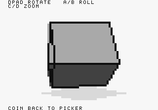
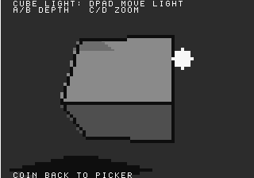

# 3Dgeo Demo / Template

[](https://github.com/sabino/3dgeo-demo/actions/workflows/build.yml)

3Dgeo is an experimental Neo Geo/ngdevkit model demo and template that treats the sprite
hardware as a tiny grayscale framebuffer for live 3D objects. It is not a
general game engine and it is not a finished rendering library. The goal is to
explore how far a framebuffer-like 3D pipeline can be pushed on Neo Geo while
still using normal cartridge assets, the 68000 CPU, and the stock ngdevkit
build flow.

| Cube: palette-shaded faces | Movable light and approximate shadow |
| --- | --- |
|  |  |

Native 320×224 emulator captures, unmodified. Geometry uses 4×4-pixel cells;
the text uses the finer FIX layer. [See all eight scenes and reproduce the captures](docs/SCREENSHOTS.md).

## Documentation

- [How the renderer works](TECHNICAL_EXPLANATION.md): cell encoding, sprite bands,
  fixed-point perspective, visibility, palette lighting, shadows, and hardware costs.
- [Develop from the template](docs/DEVELOPMENT.md): build/run, add a mesh, change the
  look, understand limits, and diagnose rendering problems.
- [Native screenshot gallery](docs/SCREENSHOTS.md): every model, visual caveats,
  and the capture/review workflow.
- [CI and publishing](docs/PUBLISHING.md), [project history](docs/HISTORY.md),
  and [commercial use / attribution](docs/LICENSING.md).

## What this project is

This is the standalone **demo/template**, not the later voxel-game experiment.
All 35 original commits are preserved unchanged. The `legacy-demo-baseline` tag
marks the starting point; see [the history guide](docs/HISTORY.md). The independent
public repository is [sabino/3dgeo-demo](https://github.com/sabino/3dgeo-demo).

GitHub Actions builds and tests pushes/PRs, provides downloadable ROM artifacts,
and prepares draft releases for `v*` tags. See the [CI and publishing guide](docs/PUBLISHING.md)
for local reproduction and the first-publication checklist.

The current ROM renders OBJ-derived primitive models through a sprite-backed
80x56 logical framebuffer. Each logical cell is represented by one 16x16 C-ROM
tile shrunk by sprite zoom to a visible 4x4 block. The 68000 rotates vertices
and normals, projects triangles, sorts faces, fills spans, applies simple
point-light shading, draws optional silhouette/detail edges, and uploads the
result to sprite VRAM on each dirty frame. This is actual software-rendered 3D,
not a raycaster or pre-rendered sprite rotation. The hardware sprites display
the CPU's low-resolution output; they do not replace the geometry calculations.

## Status

This is research code for a public Neo Geo experiment:

- The renderer is intentionally small, fixed-point, and approximate.
- OBJ files are imported at build time, not parsed by the ROM at runtime.
- Lighting is a lightweight visual cue, not a physically correct model.
- Visibility uses painter-style triangle sorting and back-face checks, not a
  Z-buffer.
- Dense meshes are expected to be slow on real hardware. The bundled ball and
  donut are deliberately low-poly.
- The code is currently optimized for readability and iteration, not for a
  locked production ABI.

## Features

- ngdevkit cart build with generated `p1`, `s1`, `c1`, `c2`, `m1`, and `v1`
  ROM data.
- Sprite microframebuffer using 320 sprite strips, with 80 active per scanline.
- FIX layer text overlay for controls and menu labels.
- Build-time OBJ conversion into compact C arrays.
- In-ROM picker for cube, pyramid, tetrahedron, ball, donut, cone, cylinder,
  and a cube light-control scene.
- Per-face grayscale palette shading.
- Seam-free coplanar face tones and 256 angular positions per revolution.
- VBlank-timed rotation, zoom, and light movement, with bounded stall recovery.
- Zoom, yaw, pitch, and roll controls.
- Movable light marker in the `CUBE LIGHT` scene.

## Requirements

- ngdevkit installed and available through `pkg-config`.
- `m68k-neogeo-elf-gcc`, `tiletool.py`, and `romtool.py` in `PATH`.
- Python 3.
- Pillow for the asset generation scripts.
- `ngdevkit-gngeo` if you want to use `make gngeo`.

This repository does not include a Neo Geo BIOS, emulator, or ngdevkit itself.

## Build

```sh
make
```

The cart is `build/viewer/rom/3dgeo_demo.zip`; hash files are alongside it.
The Makefile discovers a relocatable SDK from the compiler. Override
`NGDEVKIT_PREFIX` if your toolchain and SDK are installed separately.

## Tests

```sh
make test          # Host ASan/UBSan regressions and fixed-pose captures
make native-test   # MAME controller replay, rotation check, and screenshots
make screenshots   # MAME capture of all seven models plus the light scene
make docs-check    # Local links and reviewed screenshot/source checksums
```

Host tests need a C compiler; native tests additionally need MAME, Xvfb and
xauth. The native test uses ngdevkit's open-source BIOS, which MAME warns does
not match the official BIOS checksums. Raw captures and logs are generated under
`build/viewer/` and ignored by Git. The reviewed gallery in `docs/images/` is
committed, with emulator/version and checksum provenance. Physical hardware is
not yet verified.

The 256-step angles improve angular resolution, not the hardware frame rate.
At 60 Hz, rotation advances 84.375 degrees/second; elapsed ticks compensate for
variable render time, capped at eight ticks after stalls. Real near-plane
clipping, geometric cast shadows, and a larger renderer-module split remain
future work. Existing shadows are deliberately screen-space approximations.

## Run

```sh
make gngeo
```

The Makefile uses this keyboard mapping for GnGeo:

- Neo Geo D-pad: arrow keys
- Neo Geo A/B/C/D: `Z` / `X` / `A` / `S`
- Neo Geo START: `1`
- Neo Geo COIN: `3`
- Emulator menu: `Esc`

## ROM Controls

Picker:

- D-pad left/right: choose a model or `CUBE LIGHT`
- A: enter the selected mode

Model modes:

- D-pad: rotate yaw and pitch
- A/B: roll
- C/D: zoom in and out
- COIN: return to picker

`CUBE LIGHT` mode:

- D-pad: move the light on screen
- A/B: move the light nearer or farther in depth
- C/D: zoom in and out
- COIN: return to picker

## Project Layout

- `src/main.c` - Neo Geo runtime, renderer, input handling, and UI overlay.
- `assets/models/*.obj` - readable source meshes imported at build time.
- `tools/obj_to_model.py` - OBJ-to-C converter for the renderer.
- `tools/make_primitive_objs.py` - regenerates the low-poly primitive OBJ
  assets.
- `tools/make_sprite_tiles.py` - generates the C-ROM tile atlas used by the
  sprite framebuffer.
- `tools/make_fix_tiles.py` - generates the S-ROM/FIX font and tile data.
- `tools/gallery_probe.lua` - real-input native screenshot replay.
- `tools/publish_screenshots.py` - publishes unchanged captures with provenance.
- `tools/check_docs.py` - checks local links and gallery/source integrity.
- `docs/` - development, screenshot, history, publishing, and licensing guides.
- `TECHNICAL_EXPLANATION.md` - detailed architecture and pipeline notes.

## OBJ Import

The converter supports a deliberately small subset of Wavefront OBJ:

- `v` vertex records.
- `f` face records.
- Face index forms such as `1`, `1/2`, `1/2/3`, and `1//3`.
- Negative face indices.
- Fan triangulation for quads and polygons.
- Centered bounding-box normalization.
- Generated fixed-point triangle and edge normals.

Runtime indices are currently `u8`, so each model is capped at 255 vertices,
255 triangles, and 255 perimeter edges. Materials, textures, vertex normals,
groups, smoothing flags, and runtime OBJ text parsing are not implemented.

## Notes On The Rendering Approach

The sprite microframebuffer approach is inspired by the general technique used
by fast Neo Geo framebuffer experiments such as Doom64KB: many narrow sprite
columns become a low-resolution writable display. This project uses its own
asset generators and renderer code. No Doom64KB, DoomGeo, or NGRayEx source or
assets are included in this repository.

For the full technical walkthrough, read
[`TECHNICAL_EXPLANATION.md`](TECHNICAL_EXPLANATION.md).

## License

Project-owned code, models, and documentation are licensed under **Apache-2.0**.
Commercial and closed-source games are allowed. Retain the readable attribution
in [`NOTICE`](NOTICE), for example in your game's credits, accompanying manual,
or a bundled notices file. An in-game credit is encouraged, not mandatory.

See [`LICENSE`](LICENSE) and the [commercial-use and attribution guide](docs/LICENSING.md).
Third-party SDK/runtime components retain their own licensing obligations.
