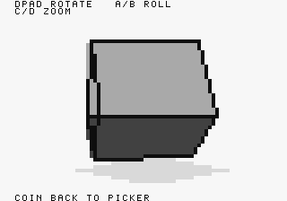
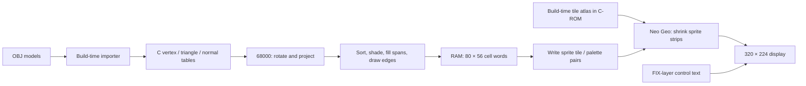
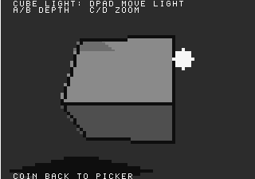

# How 3Dgeo renders 3D on Neo Geo

3Dgeo is a **software polygon renderer with a sprite-backed display**. The 68000
transforms actual 3D vertices, projects triangles, and rasterizes their faces.
The Neo Geo sprite hardware displays the result as an 80×56 grid of 4×4-pixel
cells. It does not transform meshes or rasterize triangles for us.



This is neither a raycaster nor an animation made from pre-rendered views.
The 3D geometry is real; the contact shadows, edge visibility, and illumination
are deliberately approximate. It is a single-object demo/template, not the
separate voxel-game experiment.

For results, see the [native screenshot gallery](docs/SCREENSHOTS.md).
To modify the renderer, start with the [template guide](docs/DEVELOPMENT.md).

## 1. Separate the geometry from the display

There are two pipelines: one runs on your development machine, the other on the
Neo Geo. Floating-point OBJ processing and graphics conversion happen only
during the build.



The atlas contains small reusable patterns, not pictures of cubes or pyramids.
Choosing a different model does not select a new sprite animation: it feeds
different vertex and triangle tables into the same CPU renderer.

The hardware's tiles are stored in cartridge graphics ROM. We do **not** upload
new bitmap pixels to C-ROM each frame. We change the tile references and palette
attributes in the sprite tilemaps.

## 2. What one framebuffer cell actually contains

In [src/main.c](src/main.c), the logical display is:

```c
static u16 frame_words[56][80];
word = (palette << 12) | tile;
```

The high four bits select one of this renderer's 16 palettes. The low twelve
bits identify a pattern within its atlas. That is a software encoding, not the
hardware's complete sprite attribute format.

During `blit_frame()`, one RAM word becomes two hardware words:

```c
tile_word = 256 + (word & 0x0fff);
attribute_word = (word >> 12) << 8;
```

For example, face palette 8 with solid pattern 9 is RAM word `0x8009`.
Its SCB1 tile/attribute pair is `0x0109, 0x0800`. One 16×16 source tile
then shrinks to a 4×4 screen block in the selected shade.

This avoids calculating 16 separate output pixels for a uniformly colored
block. It does **not** eliminate vertex transforms, divisions, triangle sorting,
overdraw, or the cost of writing tilemaps.

### Patterns versus colors

[make_sprite_tiles.py](tools/make_sprite_tiles.py) generates 34 atlas patterns
after 256 reserved tile slots: clear/paper, nine shade patterns, eight line
patterns, and fifteen quadrant masks. Shade 9 is solid; shades 1–8 use an 8×8
Bayer pattern. Shrinking subsamples these patterns rather than smoothing them.

Filled faces always use the solid `TILE_SHADE_9`; their brightness comes from
the palette, **not** from nine different dithered face textures. The current
edge pass uses shade 8, and contact shadows / light halos use shade 3.
Dedicated line and quadrant-mask tiles remain from earlier experiments and
are not used by the current face rasterizer.

The FIX layer separately draws the small control labels. That is why the text
has finer detail than the 4×4 geometry cells.

## 3. Why the framebuffer uses four sprite bands

A Neo Geo hardware sprite is a vertical strip of 16×16 tiles. This renderer
places 80 strips side by side, each four screen pixels wide, in four vertical
bands. It uses sprite indices 1–320.

| Band | Logical rows | Screen Y | Source tiles per strip | SCB3 height |
| --- | --- | --- | --- | --- |
| 0 | 0–15 | 0–63 | 16 | 4 |
| 1 | 16–31 | 64–127 | 16 | 4 |
| 2 | 32–47 | 128–191 | 16 | 4 |
| 3 | 48–55 | 192–223 | 8 | 2 |

SCB2's `0x033f` selects horizontal shrink 3 and vertical shrink 63.
SCB3 height is measured in **16-screen-pixel window units**, independently of
the number of source tiles. Thus a 64-pixel band needs height 4, not 16.

Two different hardware mistakes caused the historical stretched/missing faces:

1. An oversized display window kept earlier bands active over later bands.
2. Beyond sixteen shrunken source tiles, the vertical lookup repeats the last
   source line rather than continuing linearly through more tile rows.

A correct RAM framebuffer can therefore still produce a broken native screen.
The four-band layout avoids both problems. It keeps 80 strips active per
scanline, below the hardware's 96-strip limit, while using 320 of the 381
displayable sprites. See the hardware references for
[sprite limits/registers](https://wiki.neogeodev.org/index.php/Sprites) and
[shrinking caveats](https://wiki.neogeodev.org/index.php/Sprite_shrinking).

### Which registers are written?

These are **VRAM word addresses**, not CPU memory addresses.

| Block | Base | Role in this demo | Updated |
| --- | --- | --- | --- |
| SCB1 | `0x0000` | Tile number and palette/attribute pairs | Every dirty upload |
| SCB2 | `0x8000` | Shrink coefficients | Initialization |
| SCB3 | `0x8200` | Vertical position and display-window height | Initialization |
| SCB4 | `0x8400` | Horizontal position | Initialization |

Initialization sets `REG_VRAMMOD = 0x200`, so three consecutive writes starting
at SCB2 advance through SCB2, SCB3, and SCB4 for the same strip. They are not
three fields stored inside SCB2. Uploads instead set the increment to 1.

For cell `(x, y)`, the band is `y / 16`, its local row is `y % 16`, and
its sprite index is `1 + band * 80 + x`. The pair begins at
`sprite * 64 + local_row * 2` in SCB1.

## 4. Import meshes once, not every frame

[obj_to_model.py](tools/obj_to_model.py) reads OBJ `v` and `f` records.
It strips comments, resolves positive/negative vertex indices, accepts slash
forms such as `1/2/3`, and fan-triangulates polygons. Texture coordinates,
OBJ normals, materials, and smoothing groups are not used.

Vertices are centered on the bounding-box midpoint. The largest box dimension
is scaled to 240 model units and coordinates are rounded to integers. Despite
the name `MODEL_RADIUS`, this is **not** a normalization onto a radius-120 sphere.

Triangle normals are computed during import and stored in Q8 form. Face
perimeters become edge records; shared edges are not deduplicated. A quad
therefore yields two triangles but four perimeter edges, not a diagonal edge.

| Model | Vertices | Triangles | Edge records | Edge pass |
| --- | ---: | ---: | ---: | --- |
| Cube | 8 | 12 | 24 | Yes |
| Pyramid | 5 | 6 | 16 | Yes |
| Tetrahedron | 4 | 4 | 12 | Yes |
| Ball | 26 | 48 | 112 | No |
| Donut | 32 | 64 | 128 | No |
| Cone | 14 | 22 | 48 | Yes |
| Cylinder | 24 | 44 | 72 | Yes |

The importer caps each of those counts at 255 because runtime indices are
`u8`. The bundled maximums are smaller: 32 vertices, 64 triangles, 128 edges.

Normals are normally flipped outward using a convex, origin-centered heuristic.
The mesh named exactly `donut` bypasses it to preserve its inward-facing hole.
That is a hard-coded exception, not a general concave-mesh solution. Fan
triangulation is also not a robust triangulator for arbitrary concave polygons.

## 5. Rotate actual 3D points, then project them

Positions are integer model units; sine/cosine coefficients and unit normals
are Q8 (`256 == 1.0`). Do not confuse those two coordinate conventions.

[viewer_core.h](src/viewer_core.h) contains a 256-entry signed sine table.
Cosine looks up the same table one quarter-turn later. The angle byte wraps
naturally: one step is 1.40625 degrees. There is no runtime trigonometry call.

`rotate_vec()` applies pitch about X, yaw about Y, then roll about Z.
A fixed-point multiplication uses a 32-bit intermediate and shifts by eight:

```c
qmul(a, b) = ((s32)a * (s32)b) >> 8;
```

Vertices, triangle normals, and enabled edge normals use this rotation.
Truncation at each multiply makes this an approximation to an exact rotation.

Projection uses the transformed coordinates:

```text
d  = max(z + camera_distance, 160)
sx = 40 + integer_divide(x * 92, d)
sy = 28 - integer_divide(y * 76, d)
```

The camera looks toward increasing Z; a larger denominator means a farther,
smaller point. X and Y have deliberately different scale constants. The default
camera distance is 760, adjustable from 420 to 1300.

At the default distance, a transformed point `(120, 120, 0)` projects to logical
cell `(54, 16)`, whose top-left screen position is `(216, 64)`.
This is a perspective division, not an orthographic or distance-layer trick.

Clamping the denominator prevents extreme division results but is **not**
near-plane clipping. A triangle crossing the camera region is not cut into a
valid visible polygon; the renderer can distort it.

## 6. Visibility and triangle rasterization

For each render, `render_model()` transforms every vertex and triangle normal.
It sorts all triangles by mean rotated Z, farthest first, using insertion sort.
Faces with rotated normal Z below zero are then filled in that order.

This is a painter's algorithm. Later triangles overwrite earlier cells.
The normal-Z test is a cheap back-face approximation, not a per-pixel depth
test or a full perspective-facing test using the face-to-camera vector.

`fill_tri_spans()` clears two small left/right boundary arrays over the
triangle's clamped Y range. It walks the three projected edges using Q8 X
increments, collects each row's extrema, and fills the clipped horizontal span.
The whole triangle uses one shade word.

There is no depth buffer, sub-cell coverage, antialiasing, or interpolated
texture coordinate. Intersecting polygons and some non-convex views can be
ordered incorrectly. On a 4×4 grid, thin triangles and rotating silhouettes
also change in discrete steps.

Edges are drawn **after all faces**, with a Bresenham-style line walk and a
rotated edge-normal threshold of `z < -16`. They are not clipped against
already-drawn face depths. This can produce hidden-edge leaks. Ball and donut
skip this pass to avoid noisy outlines and extra work.

## 7. Lighting: a palette selection per triangle

The renderer computes a stylized point-light intensity:

```text
plane     = dot(original_normal, original_face_vertex)
light_dot = dot(rotated_normal, light_position)
intensity = ((light_dot - plane) >> 9) + 24
```

For a planar face, `normal · point` is constant over the plane. Keeping that
offset in object space avoids separately rounded transformed triangle centroids.
Cube triangles that share a face therefore receive the same shade rather than
showing an artificial diagonal lighting seam.

`face_level_for_intensity()` maps the result into twelve levels. It computes
`((intensity + 130) * 16) / 36`, clamps to 0–176, adds 8 to round, clamps again,
then shifts by four. The twelve face palettes range from dark gray to near-white.

This saves per-cell illumination calculations and palette rewrites during
animation. But it is not physically based Lambertian lighting: there is no
normalization of the light-to-surface vector, inverse-square attenuation,
specular reflection, or shadow visibility test. Equal coplanar tones also assume
consistent imported normals and plane offsets.

## 8. What the shadows and light marker really are



The ordinary scene's contact shadow is a seven-row, tapered screen-space blob
under the projected bounding box. Its horizontal radius is clamped to 8–26
logical cells. It follows the model's projected extent, not a ground plane.

The light scene offsets a similar nine-row blob away from the projected light,
with horizontal radius clamped to 10–32 cells. The function name
`draw_light_cast_shadow()` does not mean it projects mesh vertices onto a
receiver surface. Neither shadow is a geometric cast shadow.

The light marker is another CPU-drawn element in the same cell buffer. Its
radius changes with depth and is clamped to 2–6 cells. It is painted after the
model, without depth occlusion, and can leave the viewport. The light is not a
separate hardware sprite, and its on-screen marker is not a lighting pass.

## 9. VBlank timing is not the rendered frame rate

A VBlank callback increments a wrapping 16-bit clock. The loop consumes elapsed
ticks for rotation, zoom, and light movement, with an eight-tick catch-up cap.
At nominal 60 Hz, one angle step per tick is 84.375 degrees per second.

The picker and light scene redraw continuously. An ordinary model redraws only
when its controls change it. Input is sampled by the render loop, so very short
presses can still be missed when a render is slow. Returning to the picker uses
COIN/select from `REG_STATUS_B`; D-pad/buttons come from `REG_P1CNT`.

A dirty buffer is uploaded after waiting for VBlank. This schedules the
**start** of the upload; it does not prove all writes finish inside blanking.
There is one RAM framebuffer and no atomic front/back sprite-bank swap.
Tearing and timing behavior still need physical-hardware profiling.

The native regression test checks that rotation broadly tracks a held input's
VBlank interval. Its `rendered_frames` counter is diagnostic, not a certified
FPS benchmark. Emulator speed percentage is host emulation speed, not game FPS.

## 10. Cost and limits

| Resource / work | Current cost | What it means |
| --- | ---: | --- |
| Logical target | 4,480 cells | 16 physical pixels per cell |
| Main RAM cell buffer | 8,960 bytes | Two bytes per cell; not total RAM use |
| Span boundary arrays | 224 bytes | Two 56-entry signed-16 arrays |
| Sine lookup | 512 bytes | Read-only coefficients |
| Sprite strips | 320 total / 80 per scanline | Four non-overlapping bands |
| Dirty upload data | 8,960 16-bit VRAM writes | 17,920 bytes, plus address/modulo writes |
| SCB1 address selections | 320 per dirty upload | One per strip |

The fixed per-render costs are clearing all cells and uploading a dirty frame.
Variable costs include vertex/normal transforms, worst-case O(T²) insertion
sorting, visible span overdraw, and optional edge walks. A higher triangle
count can cost more even if the object covers the same screen area.

The scheme makes display cost predictable; it does not make software 3D free.
A larger logical resolution increases CPU work and can exhaust the scanline
sprite limit. Simply adding more sprite columns is not an unlimited quality
setting. Conversely, palette changes cannot reduce the number of transforms
or fix incorrect triangle ordering.

There are intentionally no universal FPS claims here. The current tests are
host sanitizers plus emulator control/capture regressions, not a formal
physical Neo Geo benchmark.

## Code-reading map

| Question | Start here |
| --- | --- |
| How does an OBJ become a C mesh? | [obj_to_model.py](tools/obj_to_model.py): `convert_model()` |
| How are 4×4 cells displayed? | [main.c](src/main.c): `init_sprite_framebuffer()`, `blit_frame()` |
| How are points transformed? | [main.c](src/main.c): `rotate_vec()`, `project_vertex()` |
| How are faces sorted and filled? | [main.c](src/main.c): `render_model()`, `fill_tri_spans()` |
| How is a shade chosen? | [main.c](src/main.c): `light_for_tri_position()`, `face_level_for_intensity()` |
| Why do shadows look approximate? | [main.c](src/main.c): `draw_contact_shadow()`, `draw_light_cast_shadow()` |
| How is movement timed? | [viewer_core.h](src/viewer_core.h), [main.c](src/main.c): main loop |
| How are screenshots reproduced? | [gallery_probe.lua](tools/gallery_probe.lua), [capture guide](docs/SCREENSHOTS.md) |

For historical alternatives, including FIX rendering and masked-cell experiments,
use the [history guide](docs/HISTORY.md). Those are preserved in Git rather than
maintained as selectable renderer backends.
