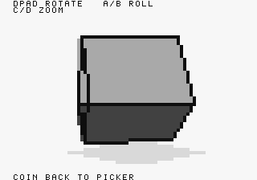
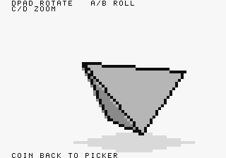
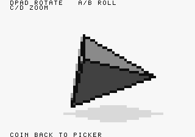
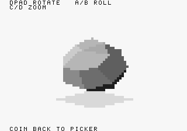
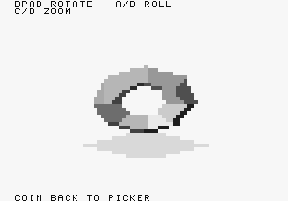
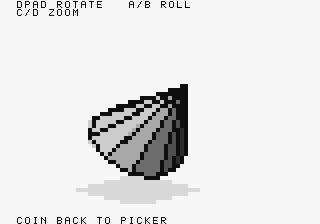
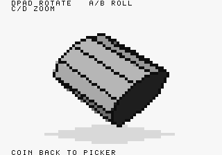
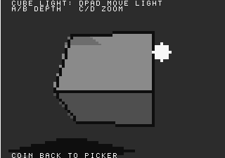

# Native rendering gallery

These are **actual 320×224 screen snapshots from the Neo Geo ROM running in
MAME**, captured through controller replay. They are not mockups, host-renderer
substitutes, or pre-rendered assets used by the demo. The PNGs are copied directly
from the emulator without cropping, retouching, or resampling.

The geometry is rasterized into an 80×56 logical buffer: each cell becomes a
4×4 screen block. Text uses the separate, finer-resolution FIX layer. Browser
scaling can soften the blocks; open an image at its original size to inspect it.

## Primitive models

| Cube — 12 triangles | Pyramid — 6 triangles |
| --- | --- |
|  |  |

The flat face tones come from palette selection. Two triangles on the same
cube face share the same lighting calculation, avoiding a diagonal shade seam.
The gray patch underneath is an inexpensive screen-space contact shadow, not
a projected mesh shadow.

| Tetrahedron — 4 triangles | Ball — 48 triangles |
| --- | --- |
|  |  |

The tetrahedron makes the coarse silhouette easy to see. The ball uses more
faces to suggest curvature but still uses flat per-triangle lighting; there is
no interpolated smooth shading. Its outline pass is disabled.

| Donut — 64 triangles | Cone — 22 triangles |
| --- | --- |
|  |  |

The donut is real non-convex geometry, not a sprite with a transparent hole.
Its importer has a name-specific normal-orientation exception. Painter sorting
still has limitations for non-convex meshes; this pose is not proof of correct
visibility from every angle. The cone shows the faceted result of a twelve-sided
base and flat shading.

| Cylinder — 44 triangles | Cube with movable light |
| --- | --- |
|  |  |

The light scene uses the same cube geometry and cell buffer. Controller input
moves the white marker and changes the face shades. Its offset shadow remains
a screen-space approximation. The marker is drawn after the model and does not
have depth occlusion.

## Reproduce the captures

Install the normal build dependencies plus MAME, Xvfb, and xauth, then run from
the repository root:

```sh
make screenshots
```

This builds the cartridge, uses ngdevkit's open-source AES BIOS, and runs
[gallery_probe.lua](../tools/gallery_probe.lua). The script selects all eight
scenes, adjusts poses through actual controller inputs, checks the selected
mode, and saves `build/viewer/gallery/*.png`. It reads debug symbols to verify
state; it never writes game RAM. `build/viewer/gallery.log` must contain
`GALLERY PASS` and eight capture records. BIOS checksum warnings are expected
because this is not SNK's official BIOS.

To update the committed gallery after changing the renderer:

1. Run `make screenshots` and visually inspect **all eight** PNGs.
2. Run `python3 tools/publish_screenshots.py` to copy the originals and record
   provenance. For a different build directory, pass `--build-dir build/example`.
3. Run `make docs-check` and commit the images, manifest, and relevant source.

[manifest.json](images/manifest.json) records emulator/compiler versions, ROM and
ELF hashes, source and image hashes, capture frame/yaw readings, and the checkout
commit at capture time. Source hashes identify local changes more precisely than
that commit alone. Captures are reproducible as a workflow, not guaranteed to be
pixel-identical across compiler, emulator, or timing changes.

CI runs this replay again and uploads its fresh captures as diagnostics. It
does not automatically overwrite the reviewed gallery. Documentation checks
reject broken local links, changed committed image bytes, and renderer/mesh
changes that require refreshed screenshots. They do not judge visual quality.

## What these images do not establish

- Physical Neo Geo hardware compatibility has not yet been verified.
- A screenshot does not measure animation smoothness or game frame rate.
- MAME's average speed percentage measures emulation speed, not rendered FPS.
- Edge visibility, near-plane behavior, and cast shadows remain approximate.

See the [rendering walkthrough](../TECHNICAL_EXPLANATION.md) for the exact
pipeline and cost model, or the [development guide](DEVELOPMENT.md) to experiment.
